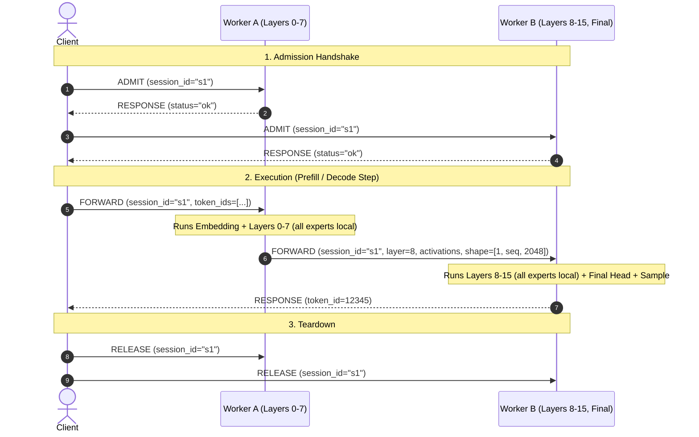

# Plan 4: First end-to-end P2P OLMoE inference

## Goal

One client discovers and selects workers, sends a prompt through partitioned OLMoE execution and receives generated text.

## Status

In planning. Connecting Plan 2's worker onboarding and Plan 3's client HTTP server.

## Pipeline Architecture

The architecture generalizes to an arbitrary number of workers $N$ covering contiguous layer stages. For initial validation and demonstration, a concrete two-stage pipeline with local expert execution is used as the test deployment:
- **Worker A:** Holds `embedding` and **Layers 0–7** (shared layer units plus all 64 experts per layer).
- **Worker B:** Holds **Layers 8–15** (shared layer units plus all 64 experts per layer) and `final` head.
- All router top-$k$ expert evaluations run locally within each worker. Network communication occurs across stage boundaries (e.g. between Layer 7 and Layer 8) and between Client and Workers.



## Requirements

- Client discovers workers via DHT using bootstrap address configured via `EVERYGPU_BOOTSTRAP` or `--bootstrap`.
- Client validates full coverage: embedding, all layers 0..15, all 64 experts per layer, and final unit.
- Client selects stage route and admits session with workers before execution. Workers independently accept or reject.
- Stage workers execute RMSNorm, QK-norm RoPE self-attention with per-session KV cache, and learned router with local experts.
- Stage workers forward activations directly to the next stage worker; client does not relay activations.
- Worker holding `final` executes final norm and `lm_head`, samples next token ID, and returns it to the client.
- Client coordinates prefill and autoregressive decode loop, streaming tokens via SSE (`stream: true`) or returning JSON (`stream: false`).
- Session resources and KV caches release cleanly on completion, error, or client abort.

## Workflow

```bash
# Start worker 1 (creates network)
uv run --group worker python -m worker --new-network

# Start worker 2 (joins network)
uv run --group worker python -m worker --bootstrap <addr>

# Start client
EVERYGPU_BOOTSTRAP=<addr> python -m client

# Query inference
curl -N -X POST http://127.0.0.1:42731/v1/chat/completions \
  -H "Content-Type: application/json" \
  -d '{"model": "olmoe", "messages": [{"role": "user", "content": "Hello"}], "stream": true}'
```

## Wire Protocol & Messages

Binary framing: `[msg_type (1B) | json_meta_len (4B BE) | json_meta (utf8) | raw_tensor_bytes]`

1. **`ADMIT` (type 1):**
   - Client $\to$ Worker: `{"session_id": "s1"}`
   - Worker $\to$ Client: `RESPONSE` `{"status": "ok"}`
2. **`FORWARD` (type 2):**
   - Client $\to$ Worker A: `{"session_id": "s1", "target": "embedding", "token_ids": [...]}`
   - Worker A $\to$ Worker B: `{"session_id": "s1", "target": "layer", "layer_idx": 8, "shape": [1, seq, 2048], "dtype": "bfloat16"}` + raw activation bytes.
   - Worker B $\to$ Client: `RESPONSE` `{"token_id": 12345}`
3. **`RELEASE` (type 3):**
   - Client $\to$ Worker: `{"session_id": "s1"}`. Workers pop session and clear KV caches.
4. **`RESPONSE` (type 4):**
   - General response envelope for status or payload return.

## Steps

1. **Execution Protocol & Transport:** Add Trio TCP execution server on workers to handle `ADMIT`, `FORWARD`, `RELEASE`. Worker advertises execution address in peer status record.
2. **OLMoE Forward Kernels:** Implement pure PyTorch forward operations for partitioned units: embedding lookup, stage attention with session KV cache, top-$k$ router with local experts, final norm, and greedy/temperature sampling.
3. **Client Discovery & Route Admission:** Connect client to DHT discovery via `EVERYGPU_BOOTSTRAP`. Select route covering embedding, contiguous stages, all experts, and final. Send admission requests to workers.
4. **Generation Loop & SSE Streaming:** Connect `POST /v1/chat/completions` to tokenization, prefill, decode loop, and SSE/JSON rendering. Release sessions on finish or error.
5. **Verification:** Verify end-to-end flow with synthetic fixture comparing partitioned execution with single-process reference.

## Decisions

- **Generalization & Testing Scope:** The two-worker deployment is the concrete test setup; routing, admission, and forward execution are built to generalize across $N$ workers.
- **Stage Expert Placement:** Each layer's 64 experts are colocated with its shared stage on the same worker; all expert evaluations are local.
- **Transport:** Direct TCP connections between peers with length-prefixed binary framing.
- **Sampling:** Final worker samples token ID and returns it to client, avoiding transferring large vocab logits over network.
- **Client Configuration:** `EVERYGPU_BOOTSTRAP` env var or `--bootstrap` argument points client to discovery.
- **Failure Handling:** Missing coverage returns HTTP 503; dropped worker aborts request and releases session.

## Learnings

None recorded.
